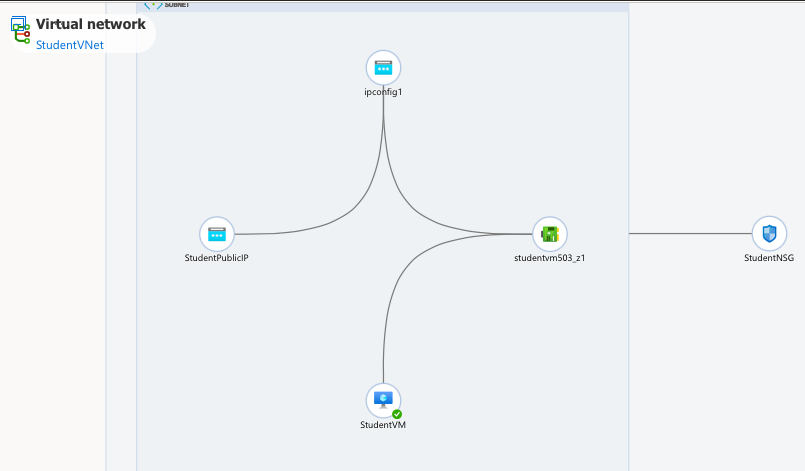

# Azure Cloud Networking Lab

## Overview

This project documents a hands-on cloud networking lab completed using Microsoft Azure for my Data and Network Communications coursework at Howard University. The lab involved creating a virtual network, configuring public and private subnets, setting up network security rules, and deploying an Ubuntu virtual machine.

## Lab Breakdown

1. Setting up the virtual network 

- Created a resource group to keep my Azure resources organized.

- Set up a virtual network with an address space of 10.0.0.0/16. to connect resources within Azure.

2. Creating Subnets 

- Created a public subnet (10.0.1.0/24) and a private subnet (10.0.2.0/24) to organize the network into smaller sections.

- Assigned IP address ranges to each subnet.

3. Network Security

- Created a Network Security Group (NSG) to control network traffic.

- Set up an inbound SSH rule on TCP port 22 to allow SSH connections from my IP address.

- Added an inbound HTTP rule on TCP port 80 to allow HTTP traffic.

- Connected the NSG to the public subnet.

4. Virtual Machine Deployment

- Set up an Ubuntu virtual machine in the public subnet.

- Checked the VM's network settings and the overall network layout.

### Key Takeaways

Learned how virtual networks and subnets work together.

Practiced controlling incoming traffic with security rules.

Got hands-on experience setting up a virtual machine in Azure.

## Network Topology
This diagram shows how the virtual machine, network interface, public IP address, and network security 
group were connected during my Azure lab in April 2026.

